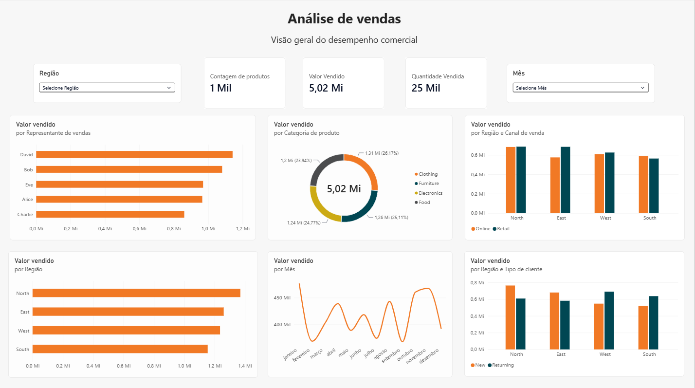

# analise-de-vendas-simples

## Sobre o projeto:
Se trata de um projeto de análise exploratória de dados que teve como objetivo compreender o comportamento das vendas e identificar padrões e diferenças entre regiões, categorias de produtos, canais de venda, representantes comerciais, tipos de clientes e períodos.

## Dashboard

## Etapas do projeto:  
- Carregamento dos dados: importação da base de vendas utilizando Python e Pandas
- Exploração inicial dos dados: verificação da estrutura dos dados, tipos de variáveis, verificação de valores nulos e registros duplicados
- Análise exploratória: Investigação das vendas por região, categoria de produto, canal de venda, representante comercial, tipo de cliente e mês.
- Análise estatística: utilização de estatísticas descritivas, gráficos e correlações para compreender o comportamento dos dados.
- Visualização dos resultados: desenvolvimento de um dashboard interativo no Power BI para apresentar os principais indicadores de vendas.
  
## Tecnologias utilizadas:
- Python
- NumPy
- Pandas
- Matplotlib
- Seaborn
- Power BI
- Jupyter Notebook

## Principais resultados:
A análise exploratória permitiu identificar os seguintes resultados:

- A região North apresentou o maior valor total de vendas, enquanto a região South apresentou o menor.
- Entre as categorias de produto, Clothing foi a que apresentou o maior faturamento.
- O canal Retail apresentou o maior valor total de vendas.
- O representante comercial David apresentou o maior valor de vendas.
- Janeiro foi o mês com maior valor total de vendas, enquanto setembro apresentou o menor.
- Não foram identificadas associações lineares relevantes entre quantidade vendida, preço unitário e desconto e o valor da venda. Igualmente, não foram identificadas associações lineares relevantes entre desconto e preço unitário e a quantidade vendida.

## Fonte dos dados:
- Foi utilizada a base de dados SALES DATA, disponibilizada no Kaggle: https://www.kaggle.com/code/vinothkannaece/sales-data/notebook
